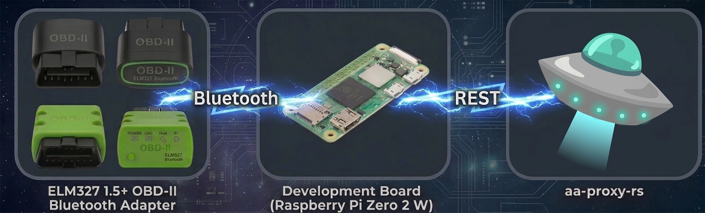

# aa-proxy-obd

## How it works


## Description
A single Linux daemon that reads live EV telemetry (battery, odometer, tire pressure, temperatures) and forwards it to a local REST consumer — designed for [aa-proxy-rs](https://github.com/aa-proxy/aa-proxy-rs) for Android Auto EV routing and dashboards. One binary serves three adapter families, selected at runtime by the config file:

| Adapter type | `device.type` | How it talks to the car |
|---|---|---|
| Bluetooth ELM327 dongle | `bluetooth` | Bluetooth RFCOMM, ELM327 AT commands |
| USB ELM327 dongle       | `usb`       | USB serial, ELM327 AT commands       |
| [WiCAN Pro](https://github.com/meatpiHQ/wican-fw) | `wican`     | BLE GATT, WiCAN AutoPid JSON          |

> **Heritage:** **aa-proxy-obd** was previously known as `canze-rs` and forked from [`manio/canze-rs`](https://github.com/manio/canze-rs.git) — the original Renault Zoe SOC logger, whose full Zoe support (TPMS, odometer, energy) lives on as the `zoe` profile. The name is a tribute to the [CanZE](https://canze.fisch.lu/) project, which remains the reference for the underlying PIDs. Its home is [`aa-proxy/aa-proxy-obd`](https://github.com/aa-proxy/aa-proxy-obd).

## Supported vehicles (ELM327 profiles)

| Vehicle | Profile | SOC | Battery (Wh) | External temp | Odometer | Tire pressure |
|---|---|:---:|:---:|:---:|:---:|:---:|
| Renault Zoe     | `zoe`    | ✅ | ✅ | ✅ | ✅ | ✅ |
| Hyundai Ioniq 5 | `ioniq5` | ✅ | ✅ | ✅ | ✅ | ✅ |
| Kia EV6         | `ev6`    | ✅ | ✅ | ✅ | ✅ | ✅ |
| Hyundai Kona Electric | `kona` | ✅ |    | ✅ | ✅ | ✅ |
| MG4             | `mg4`    | ✅ |    | ✅ |    |    |
| Kia Niro EV     | `niro`   | ✅ |    | ✅ | ✅ | ✅ |
| VW Golf Mk7     | `golf_mk7` |    |    |    |    |    |

The `zoe` profile also reads `range_km`, the estimated range in km that the car shows, with PID `223451` on the same ECU (`7E4`/`7EC`) as the state of charge. It was read from a 2016 Zoe R240 (30 km at 24 % state of charge). The value reaches aa-proxy-rs through `raw_topic`, for example as `{{ws.obd.range_km:0}}` in the overlay; aa-proxy-rs ignores it on `/battery`. A car that does not answer the PID only gets a logged failed request, and the daemon goes on with the next source.

The `zoe` profile also reads three trip and battery values, taken from the original `canze-rs`: `trip_km` (PID `2233DE`, four bytes, ×0.0001) and `trip_energy_kwh` (PID `2233DD`, ×0.001) on the `7E4`/`7EC` ECU, and `battery_module_1_temp_celsius` (PID `2104`, a multi-frame reply, byte 4 minus 40, the temperature of module 1) on the battery ECU `79B`/`7BB`. `trip_km` is sent with `odometer_km` to `/odometer`; `trip_energy_kwh` and `battery_module_1_temp_celsius` go through `raw_topic` only, like `range_km`.

The `niro` profile covers the Kia Niro EV (e-Niro, model years 2019-2026) and is checked against OBDb recordings, not on a car. It sends the same five requests as the `kona` profile, because both cars share the battery, climate, cluster and tire ECUs. `battery_level_percentage` is the state of charge the car displays and `battery_state_of_health` comes with it (PID `220105`). `external_temp_celsius`, `interior_temp_celsius` and `speed_kmh` come from the climate ECU (`7B3`, PID `220100`), which OBDb recorded on a 2024 car only; `odometer_km` and `odometer_mi` from the cluster (`7C6`, PID `22B002`); the four `tire_*_kpa` values from `7A0`, PID `22C00B`. The `220101` reply adds `battery_voltage`, `battery_current`, `aux_battery_voltage`, `battery_temp_max_celsius`, `battery_temp_min_celsius`, `battery_module_<n>_temp_celsius` (four modules) and `motor_rpm`. Like the `kona` profile it reports no Wh directly. Values that have no aa-proxy-rs endpoint reach it through `raw_topic`. The sign of `battery_current` is not documented for this car and is sent as read. Switched off with `"enabled": false`: `battery_inlet_temp_celsius`, `isolation_resistance_kohm`, `cell_voltage_max`, `cell_voltage_min`, `charge_power_available_kw`, `discharge_power_available_kw`, `charging_flag`, `dc_plug_flag`, `ac_plug_flag`, `main_relay_flag` and the four `tire_*_temp_celsius` fields.

The `kona` profile covers the first-generation Kona Electric (model years 2019-2024) and is checked against OBDb recordings, not on a car. It reports no Wh directly; with `battery_capacity_wh` set, the daemon derives `battery_level_wh` from SOC.

The `ev6`, `ioniq5` and `kona` profiles additionally report `battery_state_of_health`, `battery_voltage`, `battery_current` and `interior_temp_celsius`.

The `ev6`, `ioniq5` and `kona` profiles also read extra battery, motor and speed fields: `aux_battery_voltage`, `battery_temp_max_celsius`, `battery_temp_min_celsius`, `battery_module_<n>_temp_celsius` (five modules on the `ev6` and `ioniq5`, four on the `kona`), `motor_rpm` and `speed_kmh`. They reach aa-proxy-rs through `raw_topic` (see [Overlay data](#overlay-data-raw_topic)); aa-proxy-rs ignores them on `/battery`. Further fields are defined but switched off with `"enabled": false`: `battery_inlet_temp_celsius`, `isolation_resistance_kohm`, `cell_voltage_max`, `cell_voltage_min`, the four `tire_*_temp_celsius` fields, and on the `kona` also `charge_power_available_kw` and `discharge_power_available_kw`. Set `"enabled": true` in the profile file to read them.

The `ev6` and `ioniq5` profiles also send one extra request per poll cycle (ECU `744`, PID `22E001`) to read the charging state: `dc_charging` and `ac_charging` (1 while the car is charging). The flag bits in the `220101` reply stay 0 on these cars even while charging, so the state cannot be read from the existing request. The same reply defines these fields, switched off with `"enabled": false`: `obc_dc_voltage`, `obc_dc_current`, `obc_ac_current`, `obc_ac_voltage`, `charge_power_estimate` (watts) and `aux_battery_voltage_precise` (0.01 V resolution). The enabled fields reach aa-proxy-rs through `raw_topic`.

Adding a new vehicle requires no Rust changes — see [Vehicle profiles](#vehicle-profiles).

The `golf_mk7` profile was contributed by a Golf Mk7 owner. It reads `rpm`, `speed_kmh`, `coolant_temp_c`, `external_temp_celsius` and `fuel_level_pct` from standard OBD-II PIDs. The car reports no state of charge, so no `/battery` payload is sent (see [What it transmits](#what-it-transmits)) and its values reach aa-proxy-rs only through [`raw_topic`](#overlay-data-raw_topic), for example for the overlay. It is checked against OBDb recordings of the Golf (model years 2013-2021) and of the e-Golf built on it (2014-2020), not on a car by the maintainers.

WiCAN Pro users get whatever their AutoPid configuration exposes (typically SOC plus outdoor temperature); the WiCAN firmware decodes PIDs itself, so the daemon does not load a `profiles/` file for `device.type = "wican"`.

## What it transmits
While the adapter is reachable and the car is awake, the daemon polls and `POST`s JSON to three endpoints on `localhost`, plus `/raw-topic-data` when `raw_topic` is set. For each endpoint, it sends only if at least one relevant field was produced this cycle (absent fields are omitted); otherwise the endpoint is silently skipped.

| Endpoint | Payload |
|---|---|
| `POST {api_base_url}/battery` | `battery_level_percentage`, `battery_level_wh`, `battery_capacity_wh`, `external_temp_celsius`, `battery_state_of_health`, `battery_voltage`, `battery_current`, `interior_temp_celsius` (all optional; sent only with `battery_level_percentage` or a Wh value, because aa-proxy-rs rejects a battery payload without either) |
| `POST {api_base_url}/odometer` | `odometer_km`, `trip_km` (optional); on profiles that also read `odometer_mi` (`ev6`, `ioniq5`, `kona`), a car set to miles reports 0 km, so the miles reading is converted to km when the car reports km as 0 |
| `POST {api_base_url}/tire-pressure` | `pressures_kpa[]` (FL, FR, RL, RR; sent only when `tire_fl_kpa` was read, missing positions are `0`) |
| `POST {api_base_url}/raw-topic-data` | `{"topic": "<raw_topic>", "payload": "<JSON object of every metric read this cycle>"}`; only when `daemon.raw_topic` is set |

If the active profile reports SOC as a percentage and `battery_capacity_wh` is set in config, the daemon derives `battery_level_wh = SOC × capacity / 100` automatically when the profile doesn't report Wh directly.

[aa-proxy-rs](https://github.com/aa-proxy/aa-proxy-rs) currently consumes `battery_level_percentage`, `battery_level_wh`, `battery_capacity_wh` and `external_temp_celsius` from the battery payload; the remaining battery fields are accepted and ignored. It rejects a battery payload with neither percentage nor Wh, a percentage outside 0–100, a negative `odometer_km`, or a `pressures_kpa` list that is empty or longer than four.

### Overlay data (`raw_topic`)
With `raw_topic = "obd"` under `[daemon]`, every poll cycle also sends all metrics the profile read, under their profile field names, to aa-proxy-rs's `POST /raw-topic-data`, for example `{"topic":"obd","payload":"{\"coolant_temp_c\":88.0,\"rpm\":766.5}"}`. aa-proxy-rs keeps the latest payload per topic, and its overlay text can show a value with a placeholder such as `{{ws.obd.rpm:0}}` or `{{ws.obd.coolant_temp_c:0 | --}}` (see the aa-proxy-rs README, "Live data templates"). This works for any field name, so a profile can read values that have no aa-proxy-rs endpoint of their own, such as rpm or coolant temperature.

The overlay value is as fresh as the last poll cycle, so lower `poll_interval_secs` for fast-changing values. Payloads are not replayed when a cycle produces no data, and a payload over 4096 bytes, which aa-proxy-rs ignores, is not sent. aa-proxy-rs versions without the endpoint answer 404, which is logged as a publish failure, so leave `raw_topic` unset there.

## Usage
```
EV OBD-II telemetry logger

Usage: aa-proxy-obd [OPTIONS] [COMMAND]

Commands:
  pair  Pair the configured Bluetooth device and optionally save the passkey
  help  Print this message or the help of the given subcommand(s)

Options:
  -d, --debug            Override the configured log level to debug
  -c, --config <CONFIG>  Config file path [default: /etc/aa-proxy-obd.toml]
  -h, --help             Print help
  -V, --version          Print version
```

Without a command, the daemon loads the config, connects to the adapter and runs until SIGINT/SIGTERM. The `pair` subcommand is described under [Bluetooth pairing](#bluetooth-pairing).

## Usage with aa-proxy-rs
**aa-proxy-obd** is an EV battery logger for [aa-proxy-rs](https://github.com/aa-proxy/aa-proxy-rs). The binary is included in the aa-proxy-rs images as `/usr/bin/aa-proxy-obd`. See the official [EV Routing Feature Overview](https://aa-proxy.github.io/docs/ev#ev-routing-feature-overview) for background on the feature, and [A Unified OBD Solution](https://aa-proxy.github.io/docs/ev#a-unified-obd-solution) for the section on **aa-proxy-obd**.

1. Create `/etc/aa-proxy-obd.toml` for your adapter and vehicle (see [Config](#config--etcaa-proxy-obdtoml)), and for ELM327 adapters copy the matching profile to `/etc/aa-proxy-obd/` (see [Vehicle profiles](#vehicle-profiles)).
2. Pair the adapter if it uses Bluetooth (see [Bluetooth pairing](#bluetooth-pairing)).
3. Open your aa-proxy-rs configuration, either in the web interface or by editing `/etc/aa-proxy-rs/config.toml`, and:
   - enable EV mode (`ev = true`),
   - configure your EV connector types (`ev_connector_types`) if not already done,
   - set **`ev_battery_logger`** to `/usr/bin/aa-proxy-obd`,
   - optionally enable `odometer` and `tire_pressure` so aa-proxy-rs forwards those payloads to Android Auto as well.

aa-proxy-rs starts the daemon when an Android Auto session requests EV data and sends it SIGTERM when the session ends. The daemon polls the adapter and `POST`s to the aa-proxy-rs REST API (see [What it transmits](#what-it-transmits)); logs go to `log_file` (default `/var/log/aa-proxy-obd.log`). `ev_battery_logger` is parsed as a command line, so arguments such as `-c /path/to/other.toml` may follow the binary path.

**Coming from [aa-proxy-wican](https://github.com/aa-proxy/aa-proxy-wican)?** The setup is the same, but the `ev_battery_logger` value no longer needs the `--wican-mac-address` and `--vehicle-battery-capacity` arguments. Set `device.type = "wican"`, `bt_mac`, and `vehicle.battery_capacity_wh` in `/etc/aa-proxy-obd.toml` instead. As with aa-proxy-wican, the WiCAN Pro must have Bluetooth enabled and be in AutoPid mode, and you may need to add your phone's MAC address to the aa-proxy-rs `connect` setting so aa-proxy-rs only connects to the phone and does not try to connect to the WiCAN Pro.

## Config — `/etc/aa-proxy-obd.toml`

Only `device.type`, the device's address (`bt_mac` for `bluetooth`/`wican`, `usb_port` for `usb`), and `vehicle.profile` (for the ELM327 types) are required. Everything else is optional and falls back to the defaults shown below, so a minimal config is just:

```toml
[device]
type   = "bluetooth"
bt_mac = "AA:BB:CC:DD:EE:FF"

[vehicle]
profile = "ev6"
```

Full set of options with their defaults (an annotated copy ships as [`configs/aa-proxy-obd.toml`](configs/aa-proxy-obd.toml)):

```toml
[device]
type                      = "bluetooth"                # bluetooth | usb | wican

bt_mac                    = "AA:BB:CC:DD:EE:FF"        # bluetooth + wican; the adapter's MAC
bt_passkey                = 1234                       # optional; enables in-process pairing
bt_max_connect_retries    = 5                          # bluetooth + wican
bt_timeout_secs           = 10                         # bluetooth + wican; per-attempt connect/response timeout

usb_port                  = "/dev/ttyUSB0"             # ls -l /dev/ttyUSB* /dev/ttyACM* 2>/dev/null
usb_baud                  = 115200

[vehicle]
profile                   = "ev6"                      # ignored when device.type = "wican"
battery_capacity_wh       = 77400                      # optional; enables derived battery_level_wh

[daemon]
poll_interval_secs        = 10
car_sleep_interval_secs   = 100                        # poll interval while the car is asleep
log_level                 = "info"                     # off | error | warn | info | debug | trace
log_file                  = "/var/log/aa-proxy-obd.log"
api_base_url              = "http://localhost"
bridge_dropouts           = true
publish_failure_threshold = 5
publish_breaker_secs      = 300
cycle_failure_limit       = 20
# raw_topic               = "obd"                      # optional; also send every metric to /raw-topic-data
```

The `wican` device type connects over Bluetooth, so it shares the `bt_*` options (`bt_mac`, `bt_passkey`, `bt_max_connect_retries`, `bt_timeout_secs`). Keys under `[device]` that don't apply to the selected `type` are ignored. `poll_interval_secs` and `car_sleep_interval_secs` accept fractional values. `log_level` values other than those listed fall back to `info`. A warning names the rejected value.

The config is validated at load and a failure exits with code 1 and a message naming the key. `poll_interval_secs` and `car_sleep_interval_secs` must be finite and at least 0.1; `usb_baud` must be at least 1; `bt_mac` must not be the placeholder `AA:BB:CC:DD:EE:FF` shown in the examples above, so set it to the adapter's MAC. Unknown keys (for example a misspelled `poll_intervall_secs`) are logged as warnings and ignored.
`raw_topic`, when set, must be 1 to 64 characters of letters, digits, `_` or `-`.

Profiles are validated the same way when loaded: `vehicle.profile` may contain only `a-z`, `0-9`, `_`, `-` and `.` (no `..` or path separators), ECU IDs must be 3, 6 or 8 hex digits, PIDs hex with an even length, and each field needs a complete `byte_index`+`length` pair (length 1 to 4, or 1 to 2 in broadcast frames) or `bit_offset`+`bit_length` pair (length 1 to 16); when both are set the bit pair is used. Broadcast sources need `deadline_ms` > 0, with `can_id` of 3 or 8 hex digits.

## Vehicle profiles
Profile JSON files ship under [`profiles/`](profiles/). At install time, copy them to `/etc/aa-proxy-obd/<profile>.json` (e.g. `profiles/ev6.json` → `/etc/aa-proxy-obd/ev6.json`). The daemon lowercases `vehicle.profile` before building the path, so the file name must be lowercase.

A profile has a display `name`, an optional `elm327` block, and one or more `sources`, each with a `kind` discriminator:

```jsonc
{
  "name": "Kia EV6",
  "elm327": {               // optional; replaces the default ELM327 init sequence
    "init": ["ATZ", "ATE0", "ATAL", "ATST96", "ATCP18", "ATFCSD300000", "ATSP6"]
  },
  "sources": [ /* uds_pid and/or broadcast sources */ ]
}
```

The default init sequence shown above is what the daemon sends when `elm327` is omitted; `zoe.json` overrides it to drop `ATST96`.

### `uds_pid` source — active request/response
```jsonc
{
  "kind": "uds_pid",
  "ecu_tx": "7E4",          // request header
  "ecu_rx": "7EC",          // response filter
  "pid": "220105",          // service + PID (UDS / Mode 22 typical)
  "pre_request": "10C0",    // optional; sent before the PID, errors ignored
  "multiframe": false,      // optional (default false); opt-in to ISO-TP flow-control reassembly
  "fields": [ /* FieldSpec */ ]
}
```

### `broadcast` source — passive ATMA monitor
Only `kind` and `frames` are required; the values below are the defaults.

```jsonc
{
  "kind": "broadcast",
  "init": ["ATCRA", "ATH1", "ATS1"],
  "command": "ATMA",
  "deadline_ms": 6000,
  "idle_timeout_ms": 600,
  "stop_when": [],          // field names that end the scan early, e.g. ["external_temp_celsius"]
  "frames": [
    { "can_id": "673", "fields": [ /* FieldSpec */ ] }
  ]
}
```

### `FieldSpec`
| Key | Type | Required | Behaviour |
|---|---|:---:|---|
| `name` | string | yes | Recognised names route into a known endpoint payload; unknown names are logged but not POSTed. |
| `byte_index` | i32 | one of byte/bit | **`uds_pid`:** offset from after the UDS header (e.g. `62 XX XX`), so 0 = first data byte; negative counts from the end. **`broadcast`:** offset from the start of the CAN data bytes (no header). |
| `length` | usize | with `byte_index` | 1, 2, 3 or 4 bytes (`uds_pid`); 1 or 2 bytes (`broadcast`) |
| `bit_offset` | u32 | one of byte/bit | Motorola/big-endian bit index (bit 0 = MSB of byte 0) |
| `bit_length` | u32 | with `bit_offset` | 1..=16 |
| `multiplier` | f32 | no (default 1.0) | `raw × multiplier + offset` |
| `offset` | f32 | no (default 0.0) | as above |
| `signed` | bool | no | byte extraction only; sign-extend before scaling |
| `enabled` | bool | no (default true) | `false` keeps the definition in the file (JSON has no comments) but the value is neither read nor sent; the definition is still validated, so switching it on later cannot fail at load |

When both `bit_offset`/`bit_length` and `byte_index`/`length` are present, the bit extraction wins.

### Recognised field names
- **Battery:** `battery_level_percentage`, `battery_level_wh`, `external_temp_celsius`, `battery_state_of_health`, `battery_voltage`, `battery_current`, `interior_temp_celsius`
- **Odometer:** `odometer_km`, `odometer_mi` (used only when `odometer_km` is 0), `trip_km`
- **Tire pressure:** `tire_fl_kpa`, `tire_fr_kpa`, `tire_rl_kpa`, `tire_rr_kpa`

### Adding a vehicle profile
1. Identify the OBD ECU TX/RX headers and the PID(s) for the parameters you want. [CanZE](https://canze.fisch.lu/) is an excellent reference.
2. Work out each field's byte (or bit) offset, length, multiplier, and offset within the response payload.
3. Drop a new JSON file under `profiles/` (and copy it to `/etc/aa-proxy-obd/<name>.json`).
4. Point `profile = <name>` at it in the config. No code changes required.

## Bluetooth pairing
If `[device].bt_passkey` is set, the daemon registers a [BlueZ](https://github.com/bluez/bluez) agent at connect time that supplies the passkey during first pairing (this applies to both the `bluetooth` and `wican` device types). The agent answers only the configured `bt_mac`, and a passkey above 999999, outside the six-digit range Bluetooth uses, is rejected when the agent is registered. BlueZ ignores the agent for already-paired devices.

For one-shot setup:
```sh
aa-proxy-obd pair --passkey 1234     # or omit --passkey to be prompted
```
The subcommand discovers the device (if not already known to BlueZ, for up to 15 seconds), pairs it, and on success offers to write the passkey back into the config as `[device].bt_passkey`. Config comments and formatting are preserved.

## Failure handling
- **Per-endpoint circuit breaker.** After `publish_failure_threshold` consecutive POST failures on an endpoint (default 5), the daemon stops POSTing there for `publish_breaker_secs` (default 300s), then probes once and closes on success.
- **`bridge_dropouts`.** When enabled (default), if a cycle produces no payload for an endpoint but the previous one did, the daemon re-POSTs the last-good value so downstream sees continuity, for at most the replay limit (10 minutes, or two poll intervals if longer); an older value is dropped. The cache clears when the car sleeps.
- **Connection loss.** If the adapter link drops, the daemon disconnects and re-enters its connect/retry loop (`bt_max_connect_retries` attempts for Bluetooth types) rather than exiting.
  A single connect call (all its retries) is bounded by max(300 s, `bt_max_connect_retries` x (`bt_timeout_secs` + 20 s) + 60 s) for Bluetooth, max(300 s, `bt_max_connect_retries` x (`bt_timeout_secs` + 30 s) + 60 s) for WiCAN and 300 s for USB, and a poll by 120 s; on expiry the adapter is disconnected and reconnected, after a pause of `poll_interval_secs`. Lost links and failed connects do not count toward the watchdog below.
- **Cycle health watchdog.** If `cycle_failure_limit` consecutive poll cycles produce no data from the adapter (including cycles that end in a transient adapter error), the daemon logs an error and exits code 2 for a supervisor to act on. POST failures do not count: a healthy adapter whose endpoint is down is left to the circuit breaker. A cycle that finds the car asleep resets the counter. Set `cycle_failure_limit = 0` to disable the watchdog.

| Exit code | Meaning |
|---|---|
| 0 | Clean shutdown on SIGINT / SIGTERM (aa-proxy-rs sends SIGTERM when the Android Auto session ends) |
| 1 | Startup error — unreadable or invalid config, missing `vehicle.profile` or profile file, missing or unparseable `bt_mac`/`usb_port` |
| 2 | Cycle health watchdog tripped |

## Building
```sh
cargo build --release
```
The vendored [`.cargo/config.toml`](.cargo/config.toml) defaults the target to `aarch64-unknown-linux-gnu` so the release build cross-compiles for common SBCs (e.g. Radxa Zero 3W running an [aa-proxy-rs](https://github.com/aa-proxy/aa-proxy-rs) image). Run the test suite on the host with `cargo test --target <host-triple>`.

The code is formatted with `cargo fmt`. To check it before each commit, enable the repository's hooks once per clone:
```sh
git config core.hooksPath .githooks
```
The [`pre-commit`](.githooks/pre-commit) hook then stops a commit with unformatted code and formats it, so you can review and stage the changes.

Every push to `main` and every pull request against `main` runs [`.github/workflows/build.yml`](.github/workflows/build.yml): the formatting check, the tests on x86_64 Linux, then the aarch64 release build, uploaded as the `aa-proxy-obd-aarch64-unknown-linux-gnu` artifact of the run. The workflow can also be started by hand from the Actions tab.

## License
GPL-2.0-only. See [`LICENSE`](LICENSE).

## Credits
- Original [`manio/canze-rs`](https://github.com/manio/canze-rs.git) by Mariusz Białończyk — the Renault Zoe SOC logger and TPMS/multiframe work this fork builds on.
- The [CanZE](https://canze.fisch.lu/) project — primary reference for OBD PIDs.
- Reference projects whose capabilities this daemon absorbs: [aa-proxy-go-obd-feeder](https://github.com/aa-proxy/aa-proxy-go-obd-feeder) (USB OBD) and [aa-proxy-wican](https://github.com/aa-proxy/aa-proxy-wican) (WiCAN Pro).
